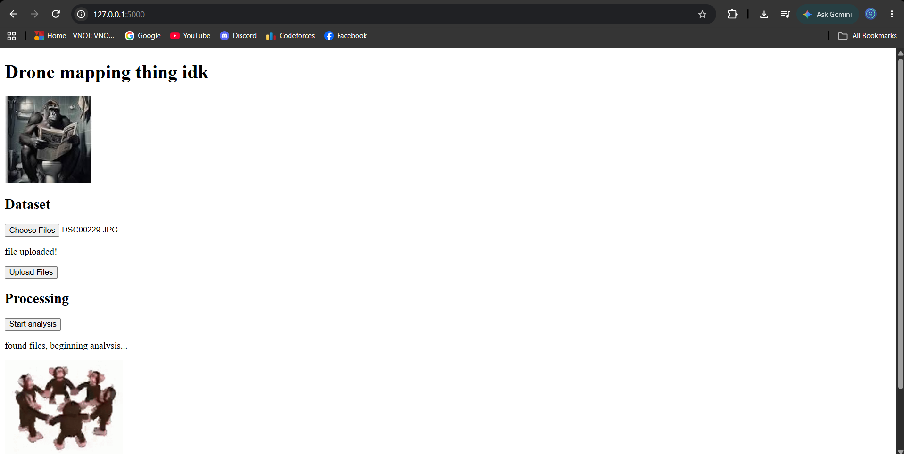
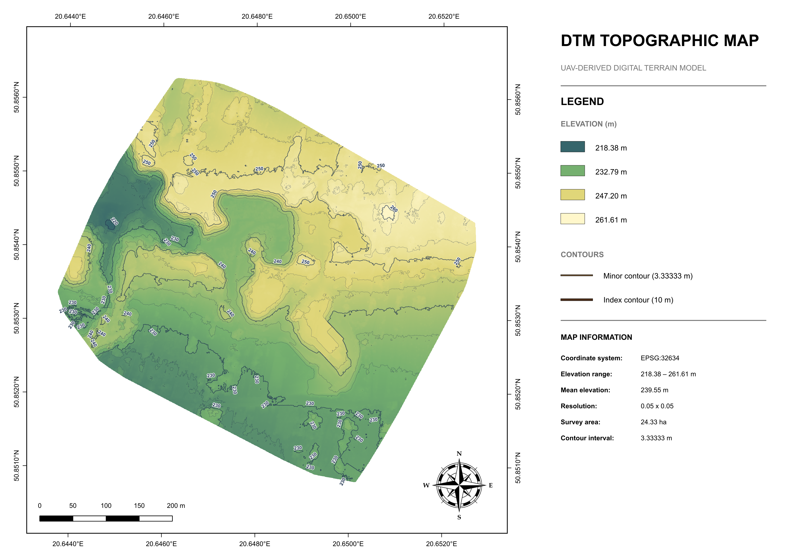
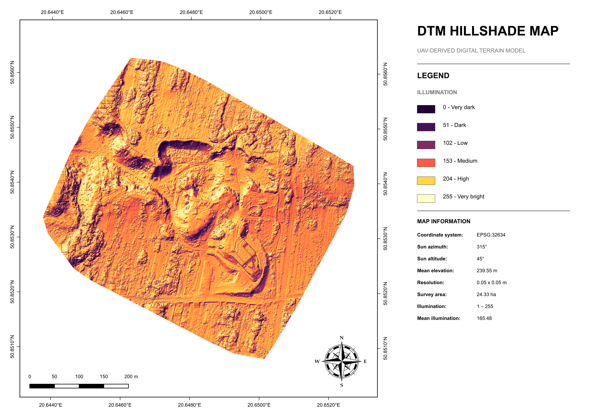
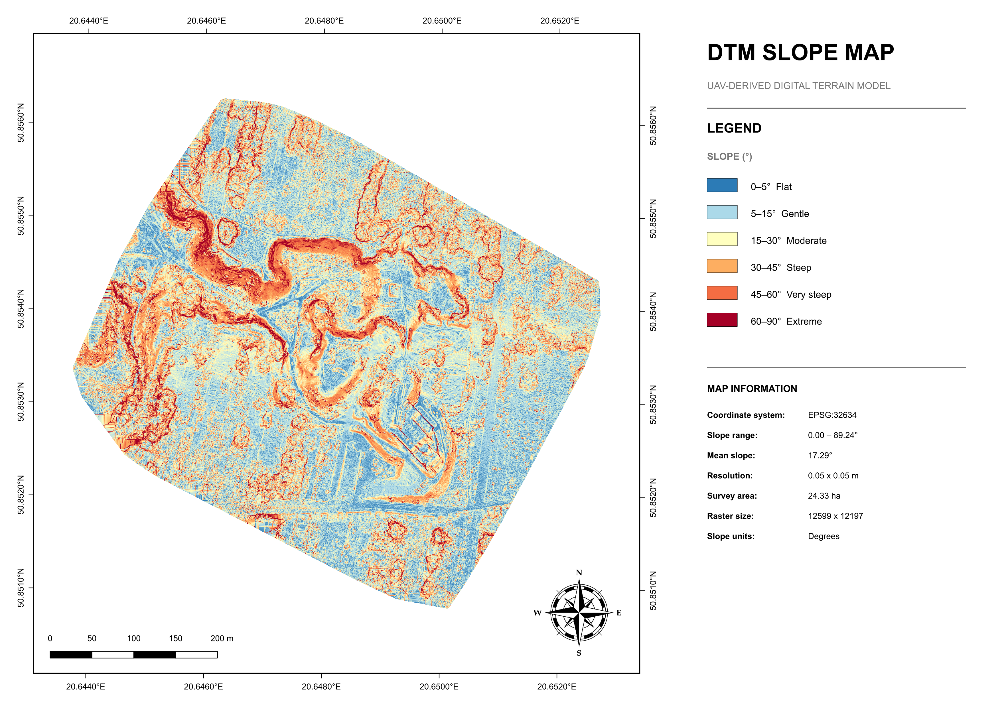
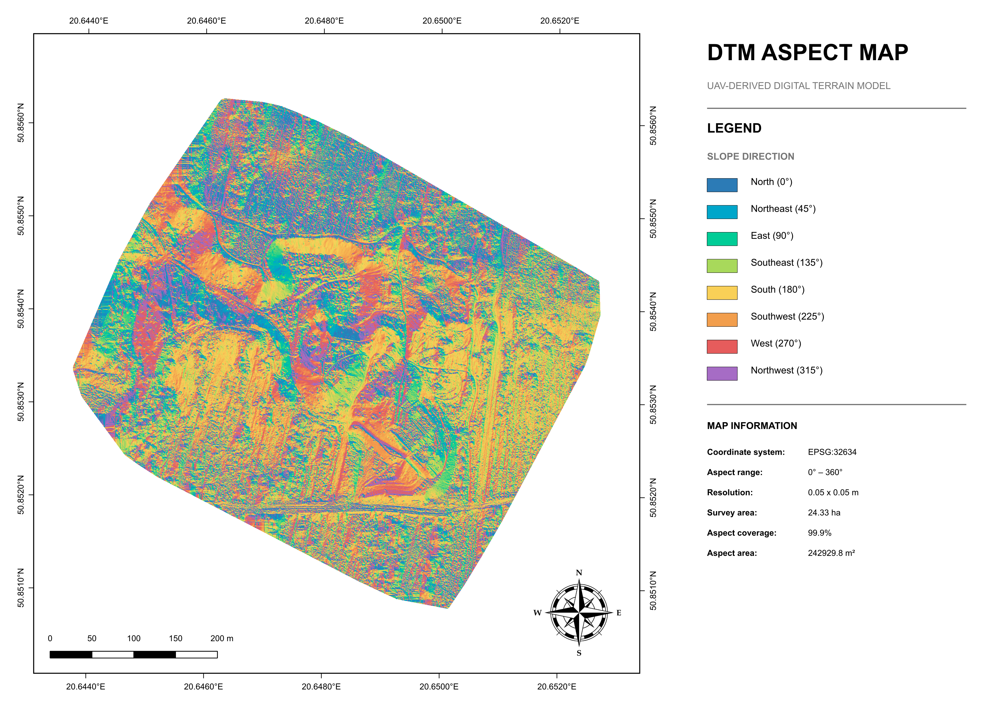

# dronething
Very roughed web for UAV processing

# Setup
## WebODM
- Install at https://webodm.org/download/, any version is fine, this project uses WebODM 3.3.1. official build 163. Also you don't have to install the Docker version.
- Once you have installed, open it, go to **Files** &rarr; **Restart in Headless Mode**, WebODM should now be hosted on http://127.0.0.1:8000 (Make sure you have WebODM hosted locally before running the project).

## QGis
- Install at https://qgis.org/download/, unlike WebODM, you **MUST** install QGis 4.2 (currently the latest version).
- Select `D://` as the installation path, you can choose any path however you like, but you must change the following variables:
    -  `QGIS_PREFIX = r"D:\QGis\apps\qgis"` into `QGIS_PREFIX = r"<Your QGis path>\apps\qgis"` in `aspect.py`, `contour.py`, `hillshade.py`, `slope.py` (located in the ./scripts folder).
    - `QGIS_PYTHON_PATH = r"D:\QGis\apps\Python312\python.exe"` into `QGIS_PYTHON_PATH = r"<Your QGis path>\apps\Python312\python.exe" in app.py` (located in root).

## How to run
- Activate the python virtual environment with the command `.venv\Scripts\activate.bat`.
- Run `app.py`.

# Some pretty pictures
## Site preview

## Some map things

